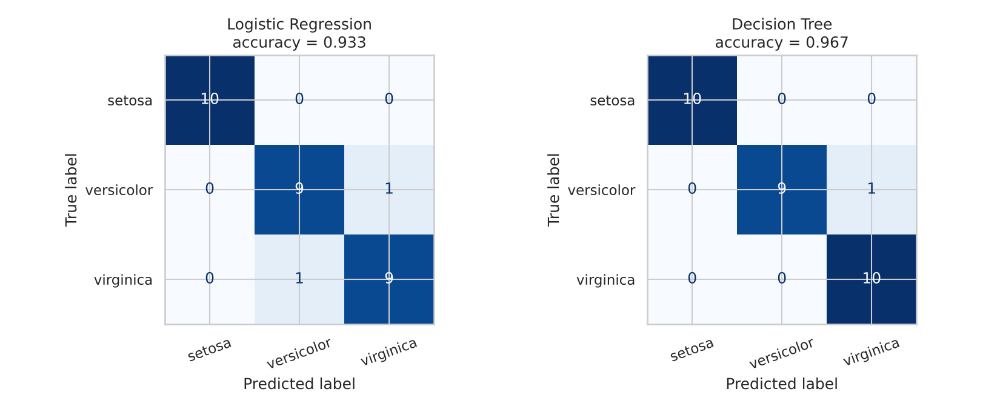
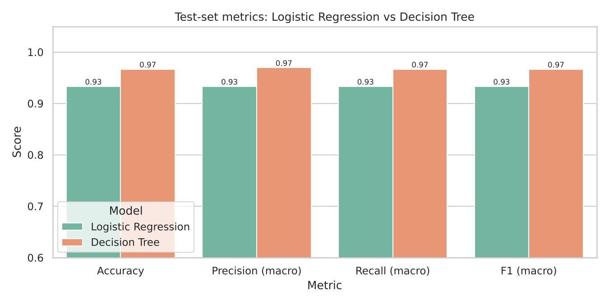
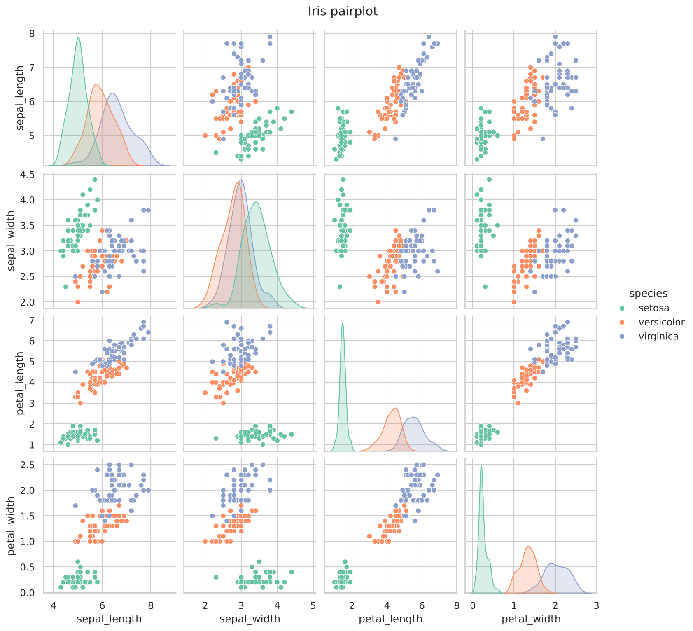
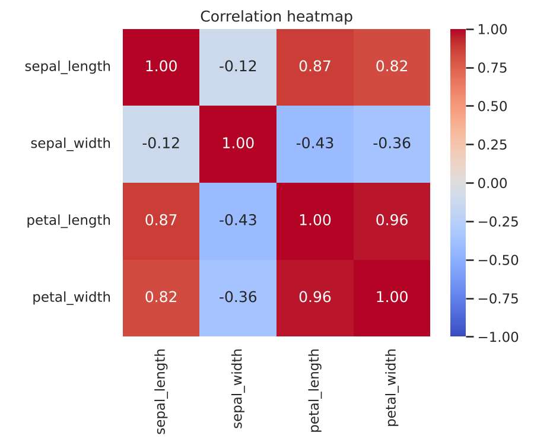
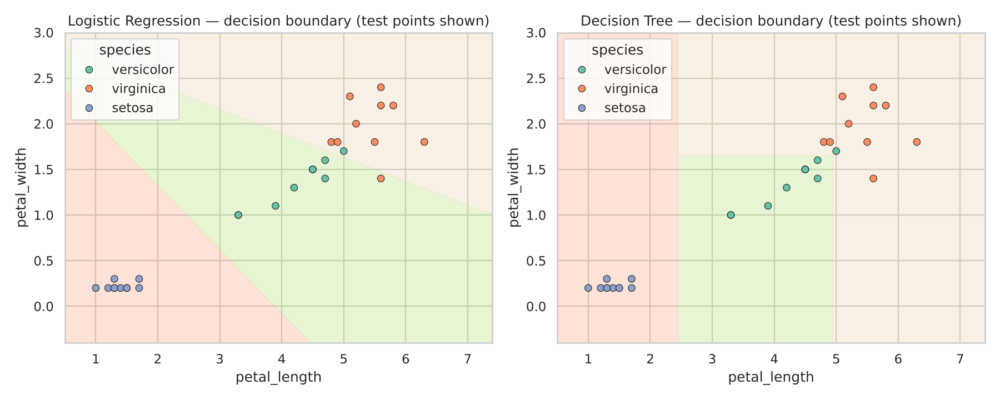
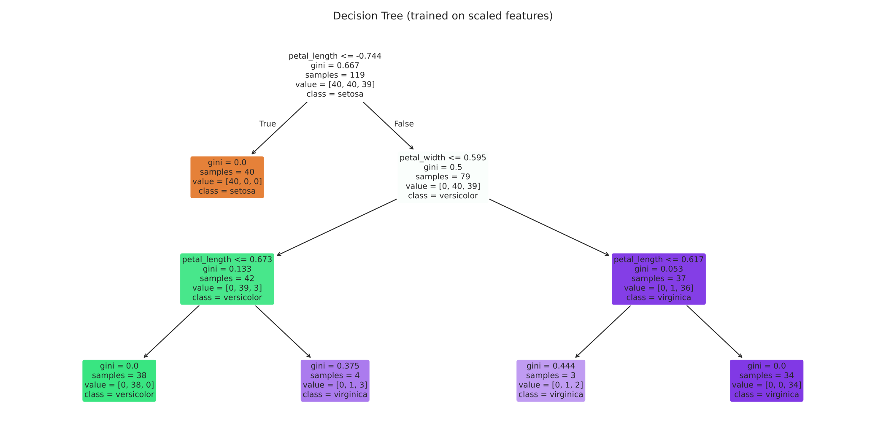

# Task 1 — Multi-Class Classification Pipeline (Iris)

## 1. Problem statement
Predict the species of an iris flower (*setosa*, *versicolor*, *virginica*) from four measurements.

## 2. Objective
Build an end-to-end scikit-learn pipeline: inspect and clean the data, visualise it, scale features, train **Logistic Regression** and a **Decision Tree**, and compare them with accuracy, precision, recall, F1 and a confusion-matrix heatmap.

## 3–4. Dataset source and description
[`iris.csv`](https://raw.githubusercontent.com/mwaskom/seaborn-data/master/iris.csv) (link from the official task pack). 150 rows × 5 columns: `sepal_length`, `sepal_width`, `petal_length`, `petal_width` (cm) and `species` (3 balanced classes). One exact duplicate row exists and is removed → **149 rows**. No missing values.

## 5. Technologies
Python · pandas · NumPy · scikit-learn (`Pipeline`, `StandardScaler`, `LogisticRegression`, `DecisionTreeClassifier`) · seaborn · matplotlib · joblib.

## 6. Installation
From the repository root: `pip install -r requirements.txt` (see the main README for the full virtual-environment steps).

## 7. Project architecture
```
iris.csv → load & validate → inspect → clean (duplicates) → EDA / pairplot / heatmap
        → X, y → stratified 80/20 split → Pipeline[StandardScaler → model]
        → 5-fold CV (train only) → fit → evaluate on test → confusion matrix, report
        → decision tree + decision boundary → predict_species() → save models + metrics.json
```

## 8. Data preprocessing
Duplicate removal · `StandardScaler` (inside the pipeline, fitted on training data only) · stratified 80 % / 20 % split (`random_state=42`: 119 train / 30 test).

## 9. Models
* **Logistic Regression** — linear, probabilistic, `max_iter=1000`.
* **Decision Tree** — `max_depth=3` to stay readable and limit over-fitting.

## 10. Training methodology
Both models are `Pipeline` objects. 5-fold stratified cross-validation runs on the training set only; the test set is used once for the final evaluation. The model for `predict_species()` is chosen by CV accuracy, not by test accuracy.

## 11. Evaluation metrics (test set, 30 flowers; macro-averaged)
| Model | Accuracy | Precision | Recall | F1 | CV accuracy |
|---|---|---|---|---|---|
| Logistic Regression | 0.9333 | 0.9333 | 0.9333 | 0.9333 | 0.9656 |
| Decision Tree | 0.9667 | 0.9697 | 0.9667 | 0.9666 | 0.9319 |

Both models classify every *setosa* correctly; errors are 1–2 flowers between *versicolor* and *virginica*. With 30 test samples, one flower = 3.3 percentage points, so the difference between the models is not statistically meaningful.

## 12. Results and graphs
| Confusion matrices | Model comparison |
|---|---|
|  |  |






## 13. How to run
```powershell
cd task-1-classification
jupyter notebook classification.ipynb      # Kernel > Restart & Run All
```
Outputs are written to `results/` and `models/`.

## 14. Limitations
Tiny, clean benchmark; 30-sample test set gives a noisy estimate; the decision-boundary plot uses only two features.

## 15. Future improvements
Repeated stratified CV, hyper-parameter search, SVM / k-NN / Random Forest comparison, and the Wine dataset as a second benchmark.
