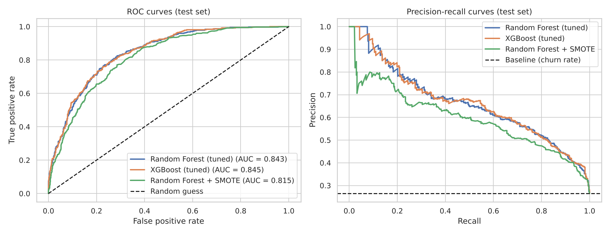
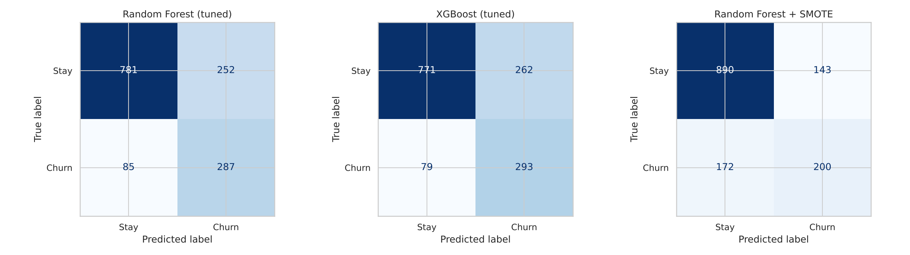
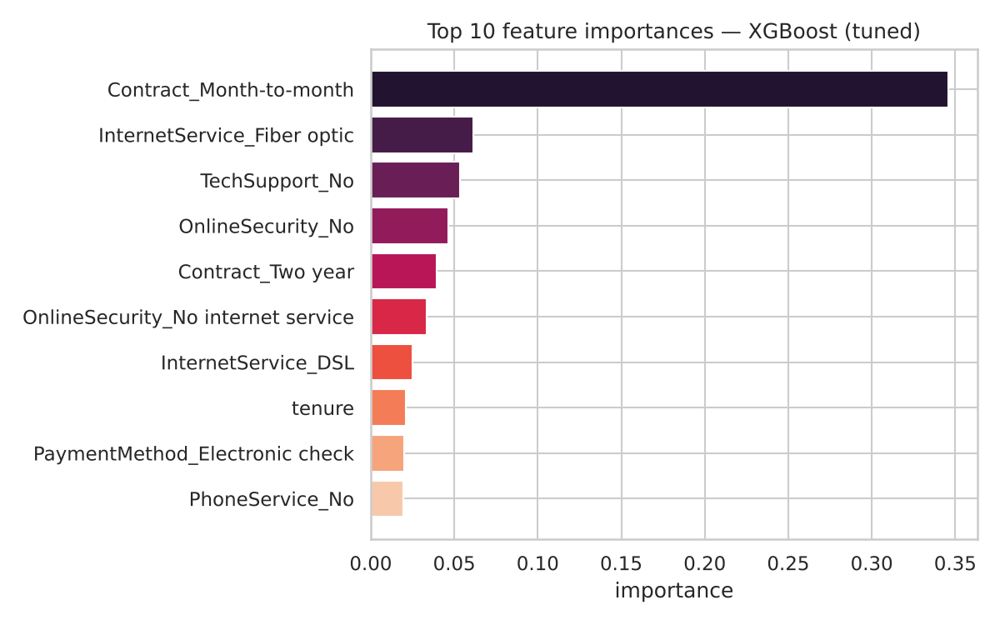
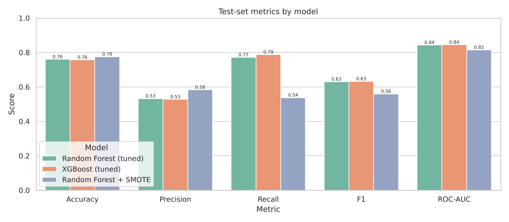
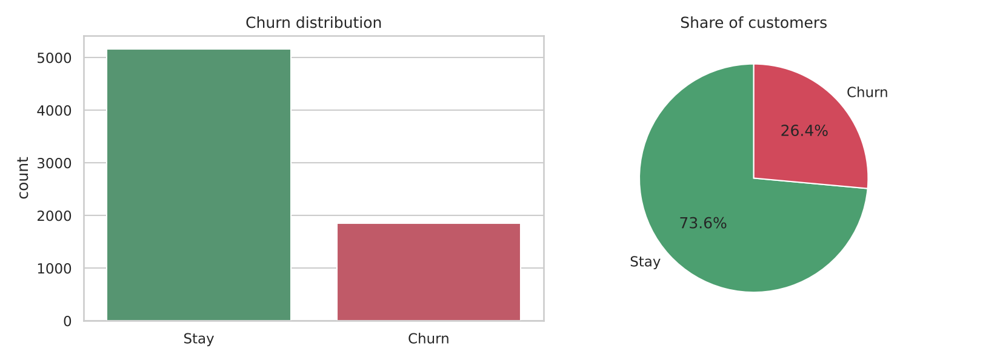
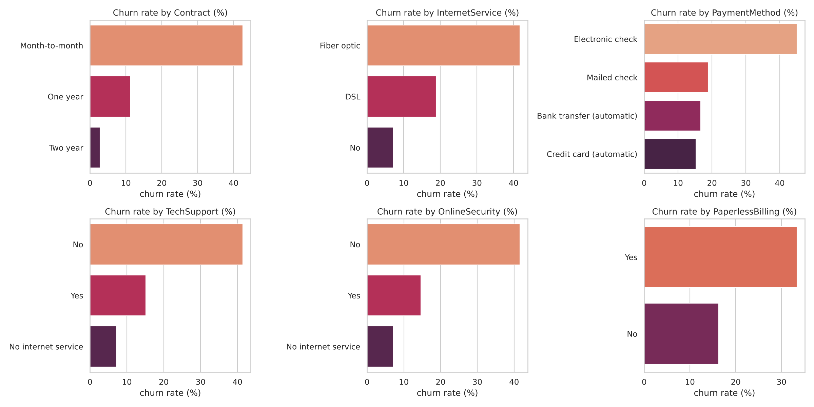

# Task 3 — Predictive Customer Churn Classifier (Random Forest & XGBoost)

## 1. Problem statement
A telecom company wants to know which customers are about to leave (`Churn = 1`) so it can target retention offers.

## 2. Objective
Clean the Telco data, engineer features, handle the class imbalance, train **Random Forest** and **XGBoost** with cross-validation and tuning, and evaluate with ROC-AUC (task-pack target **> 0.80**), a confusion matrix and feature importance.

## 3–4. Dataset source and description
IBM Telco Customer Churn ([link from the official task pack](https://raw.githubusercontent.com/IBM/telco-customer-churn-on-icp4d/master/data/Telco-Customer-Churn.csv)): 7,043 customers × 21 columns (demographics, services, contract, billing, `Churn`). `TotalCharges` is text; 11 blanks belong to customers with `tenure = 0` and are set to 0.0. After removing 22 duplicate rows: **7,021 customers, 26.45 % churn**.

## 5. Technologies
Python · pandas · scikit-learn · XGBoost · imbalanced-learn (SMOTE) · seaborn · matplotlib · joblib.

## 6. Installation
`pip install -r requirements.txt` from the repository root.

## 7. Project architecture
```
raw CSV → fix TotalCharges → drop id/duplicates → EDA → feature engineering (AvgMonthlySpend, NumServices)
   → stratified 80/20 split → Pipeline[ColumnTransformer(StandardScaler + OneHotEncoder) → model]
   → imbalance: class weights / scale_pos_weight / SMOTE (inside pipeline)
   → 5-fold CV → RandomizedSearchCV (ROC-AUC) → pick best by CV → test evaluation
   → ROC / PR curves, confusion matrices, feature importance → predict_churn() → save
```

## 8. Data preprocessing
`TotalCharges` → numeric · `Churn` → 0/1 · `OneHotEncoder(handle_unknown="ignore")` for categoricals · `StandardScaler` for numeric (Random Forest) · engineered `AvgMonthlySpend` and `NumServices`.

## 9. Models
* **Random Forest** — `class_weight="balanced_subsample"`.
* **XGBoost** — `scale_pos_weight = negatives / positives` (≈ 2.8).
* **Random Forest + SMOTE** — comparison of the second imbalance strategy; SMOTE is applied only inside the training pipeline (never before the split).

## 10. Training methodology
80 / 20 stratified split (5,616 train / 1,405 test) → 5-fold stratified CV → `RandomizedSearchCV` (RF 15 candidates, XGBoost 25, scoring ROC-AUC). The final model is selected by **cross-validated** ROC-AUC on training data; the test set is touched once.

## 11. Evaluation metrics (test set, threshold 0.5)
| Model | Accuracy | Precision | Recall | F1 | ROC-AUC |
|---|---|---|---|---|---|
| Random Forest (tuned) | 0.7601 | 0.5325 | 0.7715 | 0.6301 | 0.8433 |
| **XGBoost (tuned)** — selected | 0.7573 | 0.5279 | 0.7876 | 0.6321 | **0.8448** |
| Random Forest + SMOTE | 0.7758 | 0.5831 | 0.5376 | 0.5594 | 0.8154 |

CV ROC-AUC: RF 0.8485 · XGBoost 0.8500 · RF + SMOTE 0.8244. **Target met (> 0.80).** Selected-model confusion matrix: 771 true stays, 262 false alarms, 79 missed churners, 293 churners caught.

Top drivers: month-to-month contract (by far), fibre-optic internet, no tech support, no online security, two-year contract (protective). Importance is not causation.

## 12. Results and graphs







## 13. How to run
```powershell
cd task-3-customer-churn
jupyter notebook customer_churn.ipynb      # Restart & Run All (tuning takes a few minutes)
```

## 14. Limitations
Single static dataset; default 0.5 threshold (a business would pick it from retention cost vs. lost revenue); precision is about 53 % so many flagged customers would not have left; no calibration, drift or fairness testing → **not production-ready**.

## 15. Future improvements
Cost-based threshold, probability calibration, SHAP explanations, time-based validation, LightGBM / CatBoost comparison.
