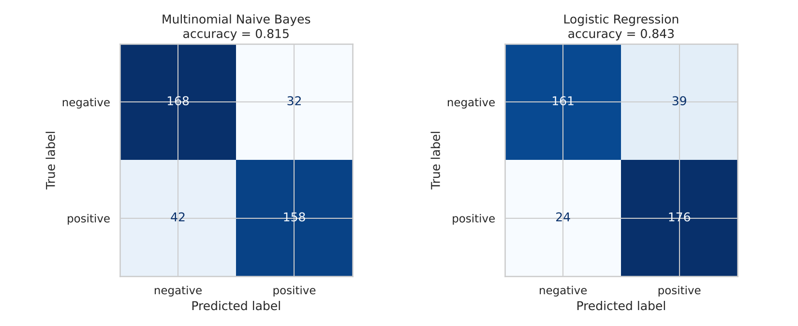
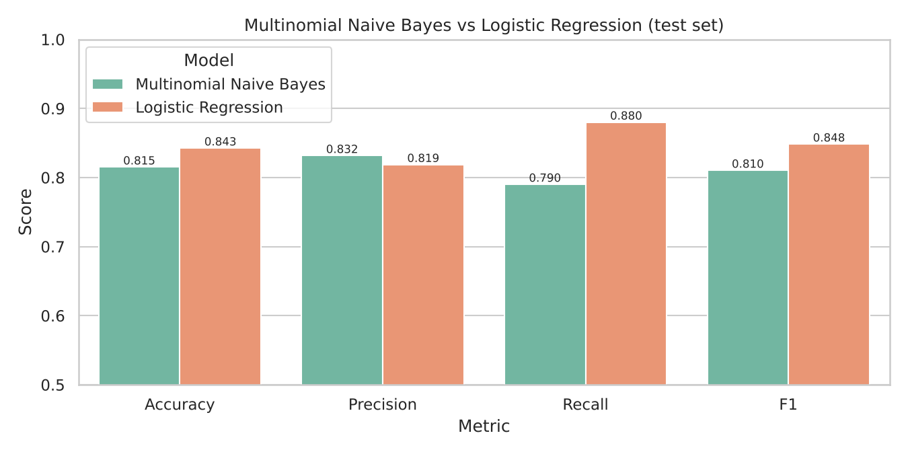
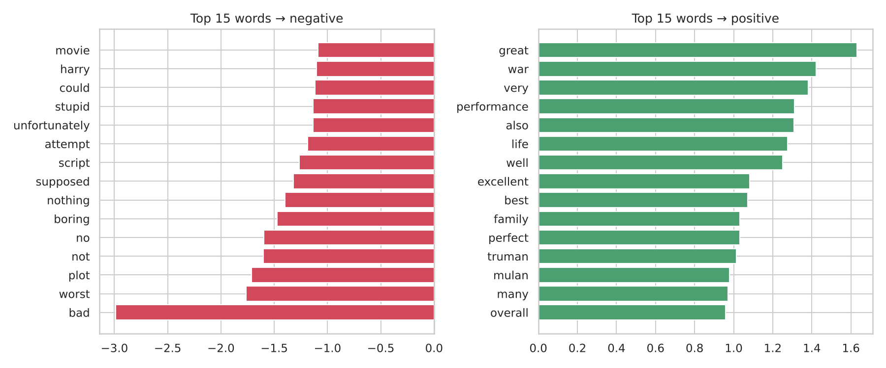
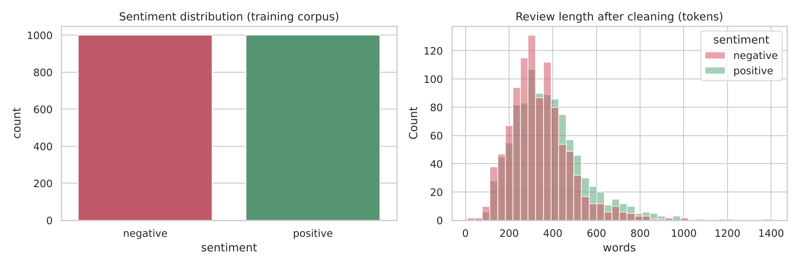

# Task 4 — NLP Sentiment Classification on Customer Reviews (TF-IDF)

## 1. Problem statement
Decide automatically whether a written review is **positive** or **negative**.

## 2. Objective
Clean raw text (HTML, punctuation, case, stopwords, lemmatisation), build TF-IDF features, train **Multinomial Naive Bayes** and **Logistic Regression**, compare them, and provide a working `predict_sentiment()` with a custom-sentence tester.

## 3. Dataset source — please read
| Role | Dataset | Size |
|---|---|---|
| Official starter file | [`sentiment_reviews.csv`](https://www.datheon.in/datasets/sentiment_reviews.csv) from the Datheon task pack (`data/sentiment_reviews.csv`) | **10 rows** (5 positive, 4 negative, 1 neutral) |
| Training + benchmark | NLTK `movie_reviews` corpus (public; downloaded automatically by the notebook) | 2,000 reviews (1,000 / 1,000) |

The official file is far too small for training or for a stratified 80/20 test set, and the task explicitly allows "customer product or movie review records". The notebook says so openly, trains on the movie corpus, and evaluates Datheon's 9 positive/negative rows separately as an external, cross-domain check. If Datheon publishes a larger file, drop it into `data/` and adapt the loader.

## 4. Dataset description
Movie corpus: raw review text with a `pos`/`neg` label (mean ≈ 750 words). Datheon file: `review_id, review_text, sentiment`.

## 5. Technologies
Python · NLTK (stopwords, WordNet lemmatiser) · scikit-learn (`TfidfVectorizer`, `MultinomialNB`, `LogisticRegression`, `Pipeline`) · pandas · seaborn · matplotlib · joblib.

## 6. Installation
`pip install -r requirements.txt`, then `python scripts/download_data.py` (or just run the notebook — it downloads the NLTK resources itself).

## 7. Project architecture
```
raw text → remove HTML → lowercase → strip punctuation/numbers → tokenise → remove stopwords (keep negations)
   → lemmatise → stratified 80/20 split → Pipeline[TfidfVectorizer(max_features=5000) → model]
   → 5-fold CV → evaluate → confusion matrices, comparison, top words → predict_sentiment() → save
```

## 8. Data preprocessing
Implemented in `src/datheon_ml/sentiment.py::clean_text`. Negations (`not`, `no`, `never`, `nor` …) are deliberately **kept**, because removing them would turn "not good" into "good". Neutral rows are dropped (binary task).

## 9. Models
* **Multinomial Naive Bayes** — probabilistic model on word weights.
* **Logistic Regression** — linear model, interpretable word coefficients.

## 10. Training methodology
Stratified 80 / 20 split (1,600 train / 400 test). TF-IDF is inside the pipeline, so vocabulary and IDF weights come from the training text only. The best model is chosen by 5-fold CV accuracy, not by the test set.

## 11. Evaluation metrics (test set, 400 reviews; positive = reference class)
| Model | Accuracy | Precision | Recall | F1 | CV accuracy |
|---|---|---|---|---|---|
| Multinomial Naive Bayes | 0.8150 | 0.8316 | 0.7900 | 0.8103 | 0.8269 |
| **Logistic Regression** — selected | 0.8425 | 0.8186 | 0.8800 | 0.8482 | 0.8431 |

External check on Datheon's 9 product reviews: **6 / 9 correct (66.7 %)** — anecdotal because the sample is tiny and the model was trained on movie reviews.

## 12. Results and graphs





## 13. How to run
```powershell
cd task-4-nlp-sentiment
jupyter notebook sentiment_analysis.ipynb     # Restart & Run All
python ../scripts/predict_sentiment_cli.py "Great quality, fast delivery!"
```
For live input inside the notebook, uncomment `interactive_demo()` in the interactive-helper cell.

## 14. Limitations
Movie-review domain vs. product-review use; unigram TF-IDF cannot fully handle negation or sarcasm (the notebook shows *"The film was not good at all"* being misclassified); no neutral class; tiny official sample.

## 15. Future improvements
Bigrams (`ngram_range=(1, 2)`), hyper-parameter tuning, a real product-review corpus, a transformer baseline (DistilBERT), and Urdu / Roman-Urdu sentiment.
